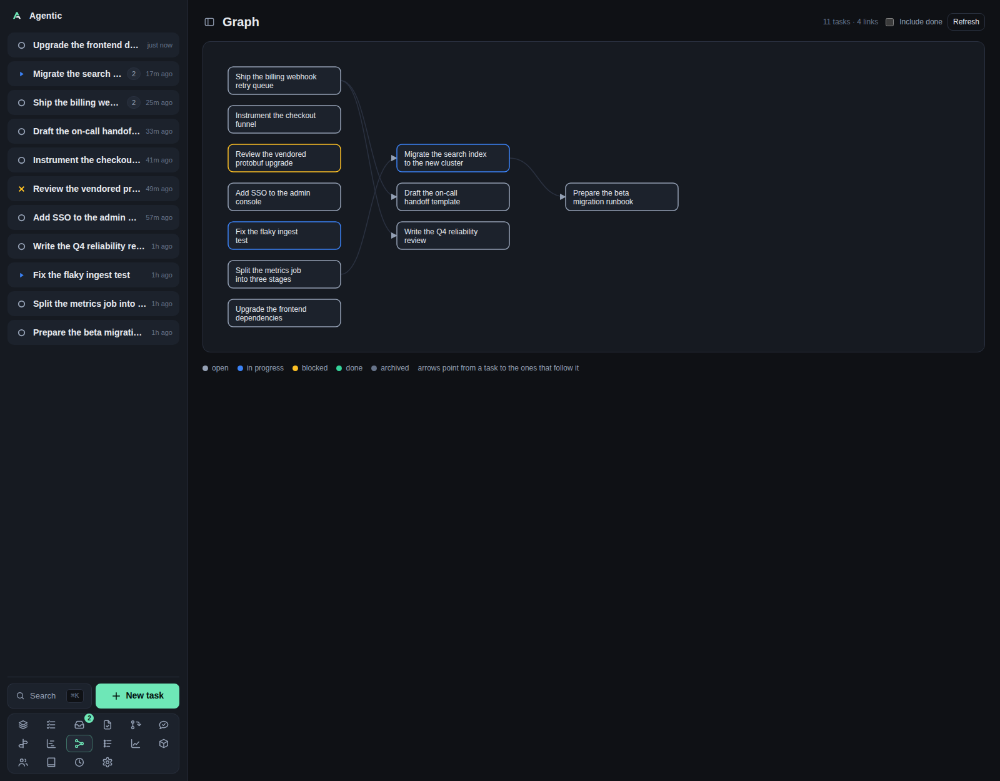

# Graph

`/graph` draws the before/after dependency graph as columns, so prerequisites sit left of the work that follows them.

## Problem

Dependencies between tasks are easy to link and hard to hold in your head, especially when a chain is several levels deep.
The graph lays every task out in layers by longest path, with arrows from a task to the tasks that follow it, so a blocked chain is visible as a pattern rather than a list.
Cycles cannot exist: the API refuses a link that would close one.

## How to use it

### The page

The header reads `Graph` with `N tasks · M links`, an `Include done` checkbox, and `Refresh`.

The panel holds a scrollable SVG.
Each node is the task's title, wrapped to three lines, and clicking it opens the task page.
Columns are layers: a task with no prerequisites sits in the first column, and a task that follows another sits one column to its right.
Columns are centred vertically, and the whole graph scrolls sideways when it is wider than the page.

The legend lists `open`, `in progress`, `blocked`, `done`, and `archived`, and states that arrows point from a task to the ones that follow it.

### Controls

| Control | What it does |
| --- | --- |
| `Include done` | Adds done and archived tasks. Off by default, reloads on change. |
| `Refresh` | Reloads the graph. |
| Node | Opens the task page. |

There is no zoom, no pan control, no persistence, and no keyboard navigation.
Scrolling is the only way around a large graph.

### Good to know

- A link to a task hidden by the filter is dropped from the drawing, so the graph thins out as you filter rather than showing holes.
- `No tasks to show. Link a task's dependencies to build the graph.` means the filtered set is empty.
- Editing dependencies happens on the task page, not here.
- Nothing polls; the graph loads on mount and when you change the filter or press `Refresh`.

## CLI and agent interface

| Operation | CLI | HTTP |
| --- | --- | --- |
| Read the whole graph | `agentic graph`, or `agentic graph --include-done` | `GET /api/graph?include_done=true` |
| Read one task's neighbours | `agentic task deps <task>` | `GET /api/tasks/{id}/dependencies` |
| Link two tasks | `agentic task link <task> <other> --relation before` | `POST /api/tasks/{id}/dependencies` |
| Unlink two tasks | `agentic task unlink <task> <other>` | `DELETE /api/tasks/{id}/dependencies/{related_id}` |

`--relation before` means the other task must be done first; omitting it makes the other task follow.
The endpoint returns nodes and edges, which is everything an agent needs to reason about the order without the drawing.

## Related

- [Tasks](tasks.md) and [Task](task.md) for the dependency chips that create these links.
- [Gantt](gantt.md) for the same tasks on a time axis.
- [CLI reference](../reference/cli.md) for `agentic graph` and `agentic task link`.
