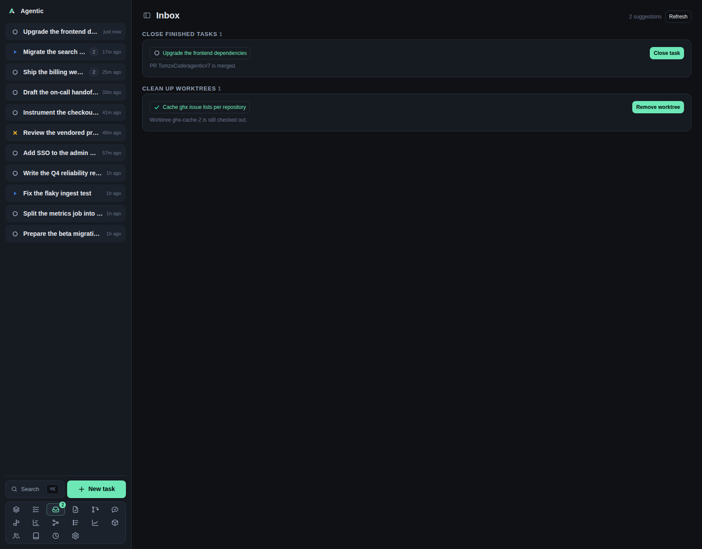

# Inbox

The Inbox at `/inbox` is a short decision queue: the bookkeeping that follows from the current state, nothing stored.

## Problem

Work leaves loose ends: a task whose pull requests all merged and closed but whose status is still open, a merged pull request with no change record, a worktree left behind by a finished task.
The Inbox lists those and gives each one a single button.
Suggestions are computed on every read, so acting on one makes it disappear instead of needing to be dismissed.

## How to use it

The page has a `Refresh` button and up to six sections, in a fixed order:

| Section | What it offers |
| --- | --- |
| `Reviews past SLO` | `Review PR` for a pull request that has awaited your review longer than the review SLO. |
| `Poke reviewers` | The requested reviewers, one row each with a poke action (a Slack DM), for one of your own pull requests that nobody has reviewed yet, past the review nudge SLO. |
| `Find a reviewer` | `Open PR` (the app's PR page) for one of your own unreviewed pull requests that nobody was asked to review. |
| `Close finished tasks` | `Close task` for a task whose linked GitHub items are all closed or merged. |
| `Record changes` | `Record change` for a merged pull request you authored that no change covers yet. |
| `Clean up worktrees` | `Remove worktree` for a done or archived task that still has a worktree on disk. |

Each row shows the task, the reason, and the actions it offers: a primary button, the reviewer rows with their pokes on an unreviewed pull request, or both.
A button is disabled while another action is in flight.

There are no filters, no sorting, no bulk actions, no keyboard shortcuts, and nothing is remembered between visits.

`Record change` creates the change already `accepted` and dates it to the pull request's merge time.
The task page's Items panel does the same for a merged pull request.
The CLI's `agentic change create` is the one path that starts at `proposed`.

### Which suggestions you get

- `Reviews past SLO` needs the review scan on and a review SLO set (see **Settings → Review requests**).
- `Poke reviewers` needs a review nudge SLO set, and counts a pull request only while nobody but its author has submitted a review (a comment review counts) and it is not a draft.
  The wait runs from when GitHub says the pull request was opened, and the row lists the reviewers GitHub still lists as requested, each with its own poke; a reviewer missing from the People directory (or without a Slack id) is reported in a toast when you poke them.
- `Find a reviewer` covers the same unreviewed pull requests whose review request names nobody, so there is no one to poke; `Open PR` takes you to the app's PR page to ask someone.
- `Close finished tasks` needs at least one linked GitHub item, all of them closed or merged, and a task that is not already done or archived. A pull request closed without merging counts.
- `Record changes` skips archived tasks and pull requests not authored by the GitHub login in **Settings → Identity**.
- `Clean up worktrees` covers done and archived tasks.
- Within a section, the newest task comes first.

### Good to know

- `Inbox zero. Nothing needs a decision right now.` is the normal state, not an error.
- A failed load shows `Could not load the inbox.` with `Retry`.
- A pull request row's title opens the app's PR page (`/pr/{owner}/{repo}/{number}`); actions that do the work, such as `Review PR` or a poke, still reach GitHub or Slack where that work happens.
- `Record change` fails with `That pull request is no longer in the resources list.` when its item was deleted.
- The sidebar badge on Inbox uses the same endpoint, so it clears as soon as you act.
- The nudge reads your open pull requests from GitHub, so with a cold cache the first inbox read of the hour can take a moment while `gh` answers.

## CLI and agent interface

The inbox itself has no command, but every action it offers does.

| Operation | CLI | HTTP |
| --- | --- | --- |
| Read the suggestions | none | `GET /api/inbox` |
| Close a finished task | `agentic task update <task> --status done` | `PATCH /api/tasks/{id}` |
| Remove a leftover worktree | `agentic worktree remove <task> <worktree>` | `DELETE /api/tasks/{id}/worktrees/{worktree_id}` |
| Record the change | `agentic change create <task> --title … --external-ref …`, then `agentic change accept <change>` | `POST /api/changes` |
| Refresh the pull request first | `agentic item refresh <item>` | `POST /api/items/{id}/refresh` |
| Poke the reviewers | none | `POST /api/my-pulls/poke` |

An agent that wants the inbox's exact outcome has to create the change and accept it in two calls, and set the dates itself: the CLI cannot create a change already accepted and dated to the merge.

## Related

- [Tasks](tasks.md) and [Task](task.md) for the pages the rows link to.
- [Metrics](metrics.md) for what the recorded changes feed.
- [How to track changes and read the metrics](../how-to/track-changes-and-metrics.md).
