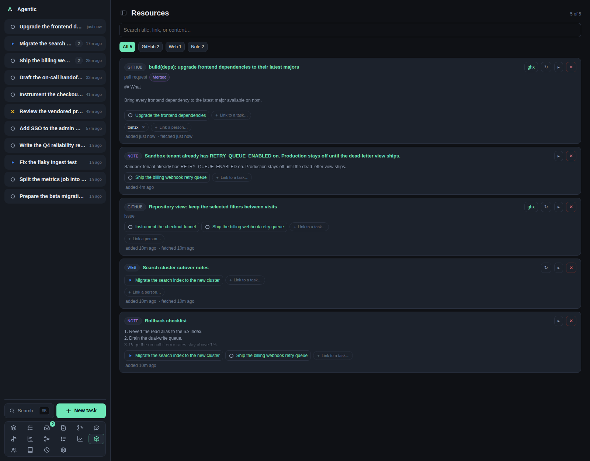

# Items

Items are the external things a task draws on: a GitHub issue or pull request, a Slack thread, a Drive doc, a URL, a commit, a file, or a note.
`/items` lists them all, and `/items/:id` is one of them.

## Problem

The evidence for a piece of work lives in other systems, and it is easy to lose track of which thread or issue is already captured and which task it belongs to.
The Items page answers "what have I pulled in, and what is still not attached to anything", and the item page shows one resource whole: its content, its reviewers, its review reports, and the tasks and people that use it.

The page header calls this page **Resources**; the sidebar calls it **Items**. It is the same list.

## How to use it

### The list (`/items`)

| Part | What it does |
| --- | --- |
| Counter | `N of M` items, after the search and source filters. |
| Search | `Search title, link, or content…`, matched in the browser against those three fields. |
| Source chips | `All` plus one chip per source present, with counts, in the order GitHub, Slack, Google Drive, Web, Note, Commit, File. |
| Item cards | Each card shows the source, the title, the URL, the content preview, and the actions. |

Per card:

- `Done` and `Reopen` mark a Slack conversation finished. A reply that arrives afterwards is flagged as new rather than reopening it.
- `ghx` and `slackx` links open the item in those tools when their URLs are configured.
- `↻` re-fetches the item's metadata and content.
- `▸` expands the body.
- `＋ Link to a task…` attaches the item to a task, and `＋ Link a person…` to a person. Person chips show `✕` to unlink.
- `✕` deletes the item and says how many tasks it will unlink first.
- `not linked to a task` marks an item nothing uses yet.

Notes get no refresh and no person linker, because there is nothing upstream to fetch.

The page loads every item and filters in the browser, so it is not the place to browse thousands of resources.
There is no page-level refresh and no per-source refresh button; **Settings → Refresh** has the per-source force refresh.

### One item (`/items/:id`)

The head shows the source and kind badges, the number and state for a pull request, an editable title, an `Open on …` link to the original service, the tool links, `Done`/`Reopen` for Slack, `Reset title` when you replaced the source's title, `Refresh`, and `Delete`.

The body depends on the source:

- **GitHub issue or pull request**: repository, author (a person link, or a grey link to create a person from that handle), state, opened and merged dates, the reviewers, and the Markdown body.
- **Slack thread**: the transcript, with a note when a message arrived after you marked it done.
- **Note**: the note text.
- **URL, commit, file**: the source, the link, and any fetched content.

Under that come two panels for pull requests:

- **Review reports** lists the report files on disk, grouped by the commit they cover, with one button per skill that wrote one. The newest report opens automatically, and a large one is truncated with a note.
- **Reviewers** lists one row per reviewer with their state (`Approved`, `Changes requested`, `Commented`, `Dismissed`, `Awaiting review`), when they last reviewed, and a `👉` button that DMs them on Slack to ask for a review. The DM resolves the GitHub login through the people directory, so the person needs that login as an alias and a Slack id among their aliases.

`Links` lists the tasks and people that use the item, and `Details` shows the source, kind, external id, and the added, fetched, and updated times.

### Good to know

- Reviewers and review reports are read once when the page loads. Only a reload re-reads them, because `Refresh` re-fetches the item alone.
- Review reports live under `AGENTIC_SDLC_DIR`, at `{owner}/{repository}/pull-requests/{number}/`.
- A reviewer read failure shows GitHub's error instead of an empty list.
- The poke needs `SLACK_TOKEN`, plus `SLACK_COOKIE` for an `xoxc-` web token, or it reports that Slack is not configured.

## CLI and agent interface

| Operation | CLI | HTTP |
| --- | --- | --- |
| List and read items | `agentic item list --source github`, `agentic item get <item>` | `GET /api/items`, `GET /api/items/{id}` |
| Create an item | `agentic item create --url … --content …` | `POST /api/items` |
| Refresh one item | `agentic item refresh <item>` | `POST /api/items/{id}/refresh` |
| Refresh what is due | `agentic item refresh-due` | `POST /api/items/refresh-due` |
| Refresh a whole source | `agentic item refresh-source github` | `POST /api/items/refresh-source/{source}` |
| Mark done or reopen | `agentic item done <item>`, `agentic item reopen <item>` | `PATCH /api/items/{id}` with `{"done": true}` |
| Rename or reset the title | none | `PATCH /api/items/{id}` with `title` |
| Delete | `agentic item delete <item>` | `DELETE /api/items/{id}` |
| Link to a task | `agentic link add <task> --item-id <item>` | `POST /api/tasks/{id}/items` |
| Link to a person | `agentic person link <person> --item <item>` | `POST /api/items/{id}/people` |
| Review reports | none | `GET /api/items/{id}/reviews`, `GET /api/items/{id}/reviews/{name}` |
| Reviewers | none | `GET /api/items/{id}/reviewers` |
| Ask a reviewer on Slack | none | `POST /api/items/{id}/poke` |

An agent can capture, refresh, and link items, but it cannot read the reviewer list, open a review report, or send the Slack poke through the CLI.

## Related

- [Task](task.md) for the items panel on a task.
- [Repositories](repositories.md) for the GitHub listing that creates items.
- [Review queue](reviews.md) for the same reports across repositories.
- [How to open items in ghx and slackx](../how-to/open-items-in-local-tools.md).
- [Configuration](../reference/configuration.md) for the review store and Slack tokens.
