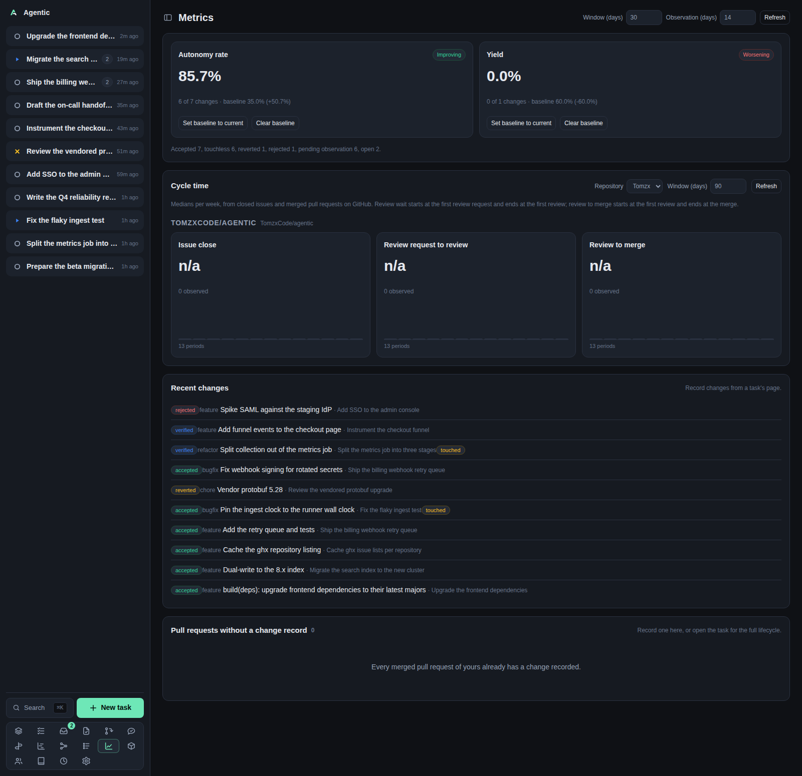

# Metrics

`/metrics` shows whether the agent is landing work you keep: autonomy rate, yield, and the cycle times behind them.

## Problem

"It feels faster" is not a measurement.
This page answers two questions with numbers: how much accepted work the agent landed without you touching it (autonomy rate), and how much of it survived its observation window (yield).
Both are shown against a baseline you store, so direction is visible, not just the value.
A cycle-time section adds where pull requests and issues actually spend their time.

## How to use it

### The controls

| Control | Default | What it does |
| --- | --- | --- |
| `Window (days)` | 30 | How far back accepted changes are counted. |
| `Observation (days)` | 14 | How long a change must survive before it counts towards yield. |
| `Refresh` | | Reloads the metrics. |

The tolerance for calling a change flat is 0.02 on the server and is not exposed in the UI.

### The metric cards

Each card shows the direction (`Improving`, `Worsening`, `Flat`, `No baseline`, or `No data`), the value as a percentage, `N of M changes`, and the baseline with the difference.

| Button | What it does |
| --- | --- |
| `Set baseline to current` | Stores the current value as the baseline for that metric, with the window and observation it was measured over. |
| `Clear baseline` | Removes the stored baseline, so the card reads `No baseline`. |

Without a baseline, a metric still shows its value and its counts; it just has no direction.

The line under the cards counts accepted, touchless, reverted, rejected, pending-observation, and open changes.

### How the numbers are computed

- Autonomy rate is touchless accepted changes divided by accepted changes in the window. A change touched by a human intervention is not touchless.
- Yield is accepted changes not reverted divided by accepted changes whose observation window has elapsed. A change still inside its window is pending and excluded, so a recent change never counts as a survivor by default.
- Direction compares the value to the stored baseline with the flat tolerance.
- Cycle times are medians per weekly bucket, computed per event.

### Cycle time

The `Cycle time` panel has a `Repository` select, its own `Window (days)` (90 by default, at most 730), and `Refresh`.

The select offers `All repositories` plus every repository with a GitHub remote, your own login first.
The choice is remembered on this device under `agentic.metricsRepository`.

Each series shows a median and `N observed` with a bar sparkline:

- **Issue close**: opening an issue to closing it.
- **Review request to review**: a pull request's first review request to its first review.
- **Review to merge**: a pull request's first review to its merge.

The server caches a repository's data for 600 seconds; `Refresh` bypasses it.

### Recent changes and the leftovers

`Recent changes` lists recorded changes with their status, class, title, task, and a `touched` badge when a human intervened.
It is unfiltered and unbounded.

`Pull requests without a change record N` lists merged pull requests you authored, linked to a task, that no change references yet.
Each row has a `Record accepted` button, which creates the change already accepted and dated to the merge.

A merge the app observes on its own is recorded without this button, so this list is what is left: no GitHub login configured, no stored author, or a merge that happened while nothing was watching.

### Good to know

- Every card reads `No baseline` until you store one; that is not an error.
- The cycle-time panel always renders; with no repository that has a GitHub remote it says `No repository has a GitHub remote yet.`
- `Every merged pull request of yours already has a change recorded.` is the good empty state of the leftovers list.
- Nothing polls; the page reloads on mount, on a window change, on `Refresh`, and after a baseline or record action.

## CLI and agent interface

| Operation | CLI | HTTP |
| --- | --- | --- |
| Read the metrics | `agentic metrics show --window-days 30 --observation-days 14` | `GET /api/metrics?window_days=&observation_days=` |
| Narrow to one task or class | `agentic metrics show --task-id <task> --change-class bugfix` | same query parameters |
| Read cycle time | `agentic metrics cycle-time --days 90 --repository <repo> --refresh` | `GET /api/metrics/cycle-time?days=&repository_id=&refresh=` |
| List baselines | `agentic metrics baseline list` | `GET /api/metrics/baselines` |
| Set a baseline | `agentic metrics baseline set autonomy_rate 0.2` | `PUT /api/metrics/baselines/{metric}` |
| Clear a baseline | `agentic metrics baseline delete autonomy_rate` | `DELETE /api/metrics/baselines/{metric}` |
| Record a change | `agentic change create <task> --title … --change-class …` | `POST /api/changes` |
| Record a merged pull request as accepted | none | `POST /api/changes` with `status`, `opened_at`, and `accepted_at` |

`agentic metrics baseline set` takes the value, `--window-days`, and `--observation-days`, so a baseline stored from the CLI carries the same measurement context as one stored from the page.
`Record accepted` has no CLI equivalent: `agentic change create` records a change at `proposed` and cannot set the accepted status or the merge dates.

## Related

- [How to track changes and read the metrics](../how-to/track-changes-and-metrics.md).
- [Inbox](inbox.md) for the same merge bookkeeping as a decision.
- [Settings](settings.md) for the GitHub login under Identity.
- [Concepts](../explanation/concepts.md) for what a change record holds.
