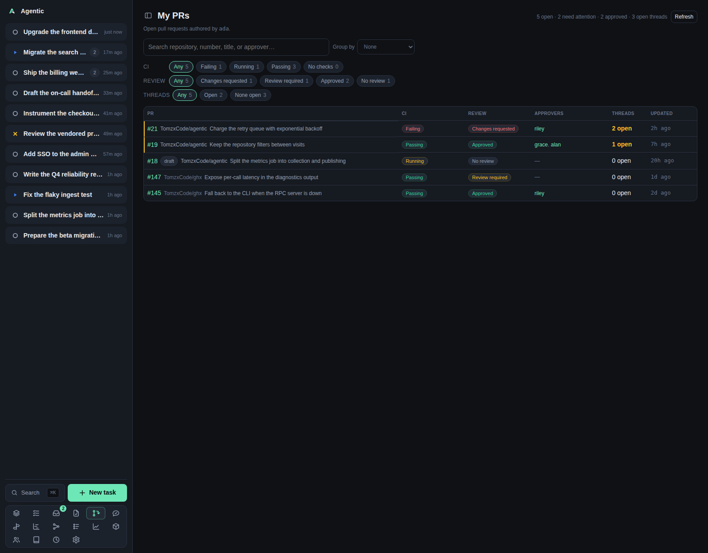

# My PRs

`/my-pulls` lists the open pull requests you authored and how close each one is to merging.

## Problem

Your own pull requests fail quietly: CI goes red, a reviewer asks for changes, a thread stays unanswered.
Checking each one on GitHub costs a tab per pull request.
This page answers "which of mine are moving, and which need a nudge" with one row per pull request, carrying its status, review decision, individual reviewers, check rollup, open comment count, merge conflicts, linked issue, description freshness, and merge readiness.

The list is read-only over GitHub: `ghx` reads each registered GitHub repository, nothing is stored, so a merged pull request leaves on the next refresh.
`ghx` caches the mergeability, the issues a description closes, the description's last edit time, and the head commit time on each pull request, so the Conflicts, Issue, Description, and Blocker columns come from the same cached listing. A row cached before those fields existed shows a dash for them and falls back to the pull request's other signals for `Blocker` (an approval, green checks, and no open comments).
A pull request's task link is resolved from the app's own stored items, so linking or unlinking a task shows on the next load without a GitHub refresh.

The read covers the repositories registered in **Repositories** that carry a GitHub remote.
A pull request in a repository neither the app nor `ghx` knows is not listed, so register a repository before expecting its pull requests here.

## How to use it

### The page

The header reads `My PRs` with a summary of open pull requests, how many are ready to merge, how many need attention, how many are approved, and how many threads are open.
The root line names the login the list was read for, taken from **Settings → GitHub** or the authenticated `gh` account.

The table has one row per pull request:

| Column | What it shows |
| --- | --- |
| PR | A `ghx` link (when a ghx web server is configured) and a `gh` link to GitHub, then the number, linking to the app's PR page; the repository (hidden when grouped by repository, linking to the app's repository page); the title; and a link to each task the pull request is associated with, if the app tracks it. |
| Status | `Open`, `Draft`, `Merged`, or `Closed`. The list reads open pull requests, so a row here reads `Open` or `Draft`. |
| Review | The review decision: approved, changes requested, review required, or no review. |
| Reviewers | The individual logins a review is still requested from, each a person link, prefixed `waiting on`; when nobody is left to review, the approvers read as `approved by`; a team-only request reads `team only`, and no reviewer at all reads `none`. A merged or closed pull request never says `waiting on`: it names only its approvers, because it no longer waits on anyone. |
| Checks | The check rollup: passing, failing, running, or no checks. Click it to list the pull request's individual checks, failing first. |
| Comments | `N open`, with a tooltip giving how many of the review threads are still open. |
| Conflicts | `none` when the branches merge cleanly, `conflicts` when they do not, and a dash when GitHub's mergeability could not be read. |
| Issue | The issue the description closes: `#12` for one, `N issues` for several, or `none` when it closes nothing. The tooltip lists every number. A dash means GitHub could not be read. |
| Description | `up to date` when the description is non-empty and was written or edited after the latest commit, `stale` when a commit came later, and `missing` when the pull request has no description. A dash means GitHub could not be read. |
| Blocker | `none` when nothing blocks the merge (including an already merged pull request); otherwise the first blocker. What the author can act on comes first: `checks failing` or `checks pending`, then `comments open`, then `needs review`, then `no reviewer`; `draft`, `closed`, `conflicts`, `behind`, and `hooks` outrank those, and `branch rules` covers a blocked merge none of them explains. The tooltip explains it (`Already merged` for a merged pull request). |
| Updated | When the pull request last changed, relative, with the full time in a tooltip. |

Every row carries a vertical edge down its first cell in the colour of the rank that placed it, and hovering the edge names the state behind it:

| Edge | State |
| --- | --- |
| Red | Failing checks |
| Orange | Changes requested |
| Amber | Open review threads (`N review thread(s) open`) |
| Blue | Checks running |
| Violet | Review required |
| Green | Approved |
| Grey | No action needed |

Each row links the pull request three ways: `ghx` opens the local ghx web UI when its URL is configured, `gh` opens the pull request on GitHub, and the number opens the app's PR page.
A pull request that is associated with a task also links that task after its title, with the task's status icon, so you can go from the pull request to the work it belongs to.

### The checks popover

Clicking a row's CI badge opens a panel listing the checks behind the rollup, the way GitHub's checks popover does.
The panel loads when it opens, because the page itself carries only the rollup state.

- Failing checks come first, then running ones, then passed ones.
- Each row names the check and its state (`Failed`, `Running`, `Passed`) and links to the check's detail page on GitHub when it has one.
- The summary line names the states present, such as `2 failing · 1 running · 8 passed`.
- The panel lists the first 100 checks; when the commit has more, it says `Showing 100 of 130 checks.`
- `View on GitHub` opens the pull request's checks tab.

The panel closes on a click elsewhere or on `Esc`.
Closing and reopening it during the visit answers from the 30-second cache.
A read that could not run says so and offers `Retry`, which bypasses that cache.

### Filtering and grouping

| Control | Options |
| --- | --- |
| Search | Matches repository, number, `#number`, title, and approver. |
| `All repositories` | The review queue's multi-select with a `Filter…` box and `Select all` / `Deselect all`. Nothing chosen means every repository, and each option carries how many pull requests it would show. |
| `Group by` | `None` (default), `Repository`, `CI status`, `Review status`. |
| `CI` chips | `Any`, `Failing`, `Running`, `Passing`, `No checks`. |
| `Review` chips | `Any`, `Changes requested`, `Review required`, `Approved`, `No review`. |
| `Threads` chips | `Any`, `Open`, `None open`. |

Chosen repositories appear in a `Selected` section above the picker's list, where tapping one removes it.
The list below offers only repositories not chosen yet.

One chip per facet is active at a time, and `Any` is the empty value.
Chip counts cover the whole list, not the filtered result, so a count tells you what is there rather than what is shown.

`Group by` is remembered on this device under `agentic.myPullsGroupBy`.
The search, the chips, and the repository selection are not.

Within a group, rows sort by attention first and newest update second.
There is no sort control.
"Needs attention" means failing CI, a changes-requested review, or at least one open thread.

### Caching and failures

Each read lists the login's open pull requests from the registered repositories' `ghx` caches, in one `ghx pr list` call that repeats `--repo`.
The cache itself is never refreshed by a page load: one background job runs `ghx cache` over the registered repositories on its own cadence (Settings → GitHub, `ghx_cache_refresh_interval`, 15 minutes by default), and it is the only caller.
The repositories are read together, and the assembled answer is cached per login and repository set for 60 seconds; a failed read is retried after 30 seconds.
`Refresh` bypasses that 60-second answer cache and reads `ghx`'s cache again; it never refreshes the cache and never forces a full re-fetch of the repository.
The checks popover caches each pull request's checks for 30 seconds.

Three failures have their own messages:

- `No GitHub login is configured; set it in Settings > GitHub to list your pull requests.`
- `No GitHub repositories are registered; add one in Repositories to list your pull requests.`
- `Could not read your pull requests from GitHub; check that \`ghx\` is installed and authenticated.`

### Good to know

- `You have no open pull requests.` is the empty state, not an error.
- The list is capped at 500 pull requests per repository, newest update first across all of them.
- A repository `ghx` cannot list makes the one batch call fail; the read then falls back to listing each repository on its own, so the unreadable repository is left out of the rows instead of hiding the readable ones. When every repository fails, the page reports the unreachable error.
- Approvers come from each pull request's latest decisive review, so a plain comment neither drops an approval nor adds one.
- The open-thread count covers the first hundred threads of a pull request; the total stays exact.
- A listing that `ghx` answers from its API fallback (a cache it could not refresh) carries the check rollup but not the thread counts.
- The cache is as fresh as the last background pass. A repository `ghx` has never fully cached is warmed by that pass too; until then its rows come from `ghx`'s per-item reads.
- The checks popover reads GitHub through `ghx pr checks` when it opens, so it is not affected by the list's `Refresh`.

## CLI and agent interface

| Operation | CLI | HTTP |
| --- | --- | --- |
| List your open pull requests | none | `GET /api/my-pulls` |
| Re-read the cached answer | none | `GET /api/my-pulls?refresh=true` |
| List one pull request's checks | none | `GET /api/my-pulls/checks?repository=owner/name&number=12` |
| Poke a pull request's reviewers on Slack | none | `POST /api/my-pulls/poke` |
| Act on one | use the review queue or a task | `POST /api/tasks` with `github_url` |

An agent can reproduce the data with `ghx pr list --author <login> --state open -R owner/name -R other/owner --json number,title,url,isDraft,createdAt,updatedAt,reviewDecision,author,reviews,reviewRequests,checks,reviewThreads` over the registered repositories, and `ghx pr checks <number> --repo owner/name --json` for the individual checks.
The app offers no command that wraps it.

The read carries `reviewed` (whether anyone but the author has submitted a review) and `requested_reviewers` (who GitHub still lists as requested) beside each row's other fields, plus `tasks` for the tasks its stored item is associated with.
The [Inbox](inbox.md)'s review nudge is built from the same read: a pull request past the nudge SLO with no reviews lists its requested reviewers with a poke each (this endpoint), or, when nobody was asked to review it, takes you to the PR page to find one.

## Related

- [Review queue](reviews.md) for the pull requests waiting on your review.
- [PR feedback](feedback.md) for the reviewer comments on these pull requests.
- [Inbox](inbox.md) for the nudge this read feeds.
- [Settings](settings.md) for the GitHub login under GitHub.
- [Configuration](../reference/configuration.md) for `AGENTIC_REVIEW_SCAN_*` and `AGENTIC_GITHUB_LOGIN`.
