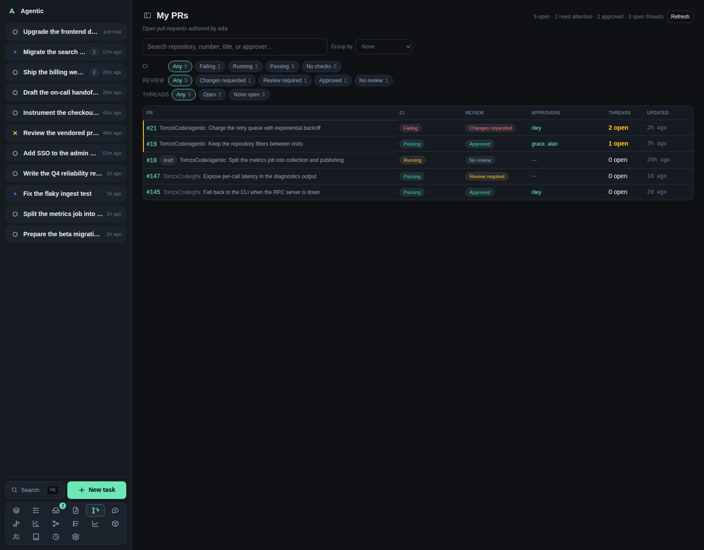

# My PRs

`/my-pulls` lists the open pull requests you authored and how close each one is to merging.

## Problem

Your own pull requests fail quietly: CI goes red, a reviewer asks for changes, a thread stays unanswered.
Checking each one on GitHub costs a tab per pull request.
This page answers "which of mine are moving, and which need a nudge" with one row per pull request, carrying its check rollup, review decision, approvers, and open thread count.

The list is read-only over GitHub: nothing is stored, so a merged pull request leaves on the next refresh.

## How to use it

### The page

The header reads `My PRs` with a summary of open pull requests, how many need attention, how many are approved, and how many threads are open.
The root line names the login the list was read for, taken from **Settings → Identity** or the authenticated `gh` account.

The table has one row per pull request:

| Column | What it shows |
| --- | --- |
| PR | The number, linking to GitHub, a `draft` badge, the repository (hidden when grouped by repository, linking to the app's repository page), and the title. |
| CI | The check rollup: passing, failing, running, or no checks. |
| Review | The review decision: approved, changes requested, review required, or no review. |
| Approvers | The logins whose latest decisive review approves, each a person link, or a dash when none are known. |
| Threads | `N open`, with a tooltip giving how many of the review threads are still open. |
| Updated | When the pull request last changed, relative, with the full time in a tooltip. |

A row that needs attention is styled as such.

### Filtering and grouping

| Control | Options |
| --- | --- |
| Search | Matches repository, number, `#number`, title, and approver. |
| `All repositories` | The review queue's multi-select with a `Filter…` box and `Select all` / `Deselect all`. Nothing chosen means every repository, and each option carries how many pull requests it would show. |
| `Group by` | `None` (default), `Repository`, `CI status`, `Review status`. |
| `CI` chips | `Any`, `Failing`, `Running`, `Passing`, `No checks`. |
| `Review` chips | `Any`, `Changes requested`, `Review required`, `Approved`, `No review`. |
| `Threads` chips | `Any`, `Open`, `None open`. |

One chip per facet is active at a time, and `Any` is the empty value.
Chip counts cover the whole list, not the filtered result, so a count tells you what is there rather than what is shown.

`Group by` is remembered on this device under `agentic.myPullsGroupBy`.
The search, the chips, and the repository selection are not.

Within a group, rows sort by attention first and newest update second.
There is no sort control.
"Needs attention" means failing CI, a changes-requested review, or at least one open thread.

### Caching and failures

The server caches the GitHub answer per login for 60 seconds and retries a failed read after 30 seconds.
`Refresh` bypasses that cache.

Two failures have their own messages:

- `No GitHub login is configured; set it in Settings > Identity to list your pull requests.`
- `Could not read your pull requests from GitHub; check that \`gh\` is installed and authenticated.`

### Good to know

- `You have no open pull requests.` is the empty state, not an error.
- The list is capped at 500 pull requests, newest update first.
- Approvers come from review decisions on GitHub, so a stale approval shows until GitHub updates it.

## CLI and agent interface

The page is the only surface for this data: there is no `agentic` command, and the single endpoint is read-only.

| Operation | CLI | HTTP |
| --- | --- | --- |
| List your open pull requests | none | `GET /api/my-pulls` |
| Force a fresh GitHub read | none | `GET /api/my-pulls?refresh=true` |
| Act on one | use the review queue or a task | `POST /api/tasks` with `github_url` |

An agent can reproduce the data with `gh search prs` and `gh pr view`, but the app offers no command that wraps it.

## Related

- [Review queue](reviews.md) for the pull requests waiting on your review.
- [PR feedback](feedback.md) for the reviewer comments on these pull requests.
- [Settings](settings.md) for the GitHub login under Identity.
- [Configuration](../reference/configuration.md) for `AGENTIC_REVIEW_SCAN_*` and `AGENTIC_GITHUB_LOGIN`.
