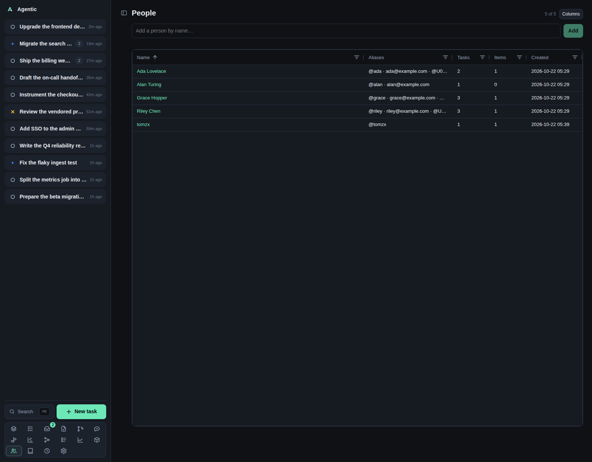

# People

`/people` is the directory of humans a task or an item involves, `/person/new` creates one from a handle, and `/person/:id` is one person.

## Problem

The same person appears as a GitHub login, a Slack user id, and an email, and each source spells them differently.
The directory keeps one person per human, with many aliases, so a reviewer, an author, a requester, and a resource owner all resolve to the same row.
That is what lets a task say `Waiting on Ada` and what lets the review poke find Ada's Slack id from a GitHub login.

## How to use it

### The list (`/people`)

The page is an AG Grid table with `People` and an `N of M` counter.

| Column | What it shows |
| --- | --- |
| `Name` | A link to the person page. Sorted ascending by default. |
| `Aliases` | Every handle and email. A Slack user id shows as `Name (@U0123…)` when slackx can name it, an email as the address, anything else as `@handle`. |
| `Tasks` | How many tasks link the person, with a number filter. |
| `Items` | How many items link them, with a number filter. |
| `Created` | When the person was added, as an absolute date and time. |

Every column sorts, resizes, and filters from its header.
`Columns` opens the column chooser, which remembers your choice on this device under `agentic.gridColumns.people`.

To add a person, type a name in `Add a person by name…` and press `Enter` or `Add`.
The button is disabled while the field is empty or an add is in flight.

### Creating a person from a handle (`/person/new`)

Grey author links across the app point here with the name and alias in the query string.
Both fields are prefilled, the page explains that no person carries the handle yet, and `Create person` saves and redirects to the new person.

`Aliases` takes a comma-separated list.
Values are trimmed and duplicate values (ignoring case) are dropped.

### One person (`/person/:id`)

| Part | What it does |
| --- | --- |
| Name | Editable in place. `Delete` removes the person and their links, after a confirmation. |
| Aliases | `✕` removes one; `Add a handle or email…` and `Add` append. A duplicate is ignored silently. |
| Notes | Free text, saved on blur. |
| Relationships | The tasks they are on (as `people` or `requested by`) and the items they are linked to, grouped by source. Each chip opens the task or item. |
| Merge | `Merge into…` picks another person; the confirmation names how many aliases and links move; the page then redirects to the target. |

Merging is the fix for a duplicate person: it absorbs the source person's aliases and links and removes the source.

### Good to know

- People are a flat directory: a name, a set of aliases, and notes. A handle and an email are the same kind of value.
- Deleting a person removes their links, so a task waiting on them shows no person afterwards.
- New people start with no links, so the list sort and the relationship panels stay empty until you attach them.
- There is no Refresh button; each save reloads the person and the list.

## CLI and agent interface

| Operation | CLI | HTTP |
| --- | --- | --- |
| List and read | `agentic person list`, `agentic person get <person>` | `GET /api/people`, `GET /api/people/{id}` |
| Create | `agentic person create --name "Ada Lovelace" --aliases ada --aliases ada@example.com` | `POST /api/people` |
| Update | `agentic person update <person> --name … --aliases … --notes …` | `PATCH /api/people/{id}` |
| Delete | `agentic person delete <person>` | `DELETE /api/people/{id}` |
| Merge | `agentic person merge <person> --into <other>` | `POST /api/people/{target}/merge` |
| Link to a task | `agentic person link <person> --task <task>` | `POST /api/tasks/{id}/people` |
| Link a requester | `agentic person link <person> --requested-by <task>` | `POST /api/tasks/{id}/requesters` |
| Link to an item | `agentic person link <person> --item <item>` | `POST /api/items/{id}/people` |
| Unlink | `agentic person unlink <person> --task … --item … --requested-by …` | `DELETE` on the same paths |

`--aliases` replaces the whole list on update, so an agent must send every alias it wants kept.
The CLI has no equivalent for the Slack user id display names, and none for the column chooser.

## Related

- [Task](task.md) for the people, requesters, and `Waiting on` field.
- [Items](items.md) for the author link and the reviewer poke.
- [Review queue](reviews.md) for the author column.
- [CLI reference](../reference/cli.md) for the `person` commands.
