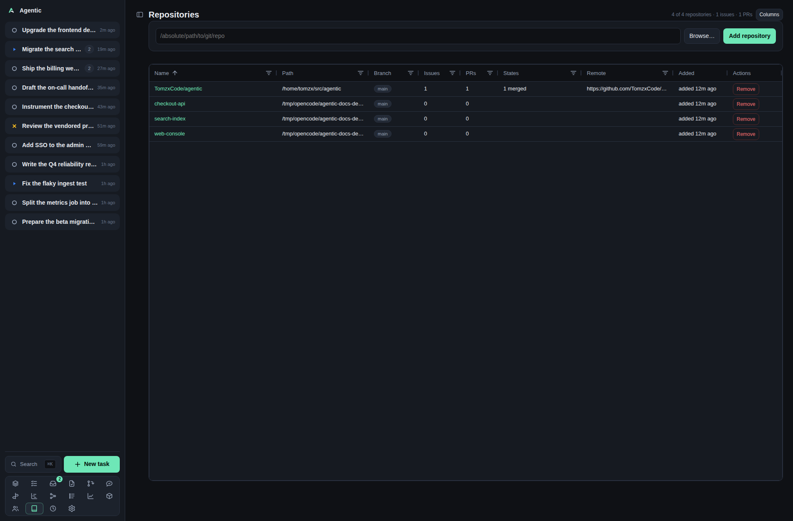

# Repositories

`/repositories` registers the local git checkouts Agentic works in, and `/repositories/:id` shows one repository's GitHub issues and pull requests overlaid with what is already linked to tasks.

## Problem

Agent work needs a checkout, and the issues and pull requests worth working on are spread across the repositories you have cloned.
Registering a checkout tells Agentic where a task's worktree comes from, and the repository page answers "what is open here, which of these already has a task, and which merged pull request still has no change record".

## How to use it

### The list (`/repositories`)

The header counts repositories, issues, and pull requests (`N of M repositories · X issues · Y PRs`), and `Refresh` re-reads each checkout's `origin` and updates any changed remote or derived name; `Columns` opens the column chooser, remembered on this device under `agentic.gridColumns.repositories`.

| Column | What it shows |
| --- | --- |
| `Name` | A link to the repository page. It is `owner/repo` when `origin` is a GitHub remote, and the folder name otherwise. |
| `Links` | A `ghx` link when the ghx URL is configured and a `gh` link to the repository on GitHub when `origin` is a GitHub remote. |
| `Path` | The checkout on disk. |
| `Branch` | The repository's default branch, with a multi-select filter. |
| `Issues`, `PRs` | Counts, with number filters. |
| `States` | A short summary such as `3 open · 1 merged`. |
| `Remote` | The git remote URL. |
| `Added` | When the repository was registered. |
| `Actions` | `Remove`, which asks for confirmation and deletes no files. |

The counts come from the items already linked to tasks whose URL matches the repository's remote, not from a live GitHub read.

### Adding repositories

Type an absolute path in `/absolute/path/to/git/repo` and press `Enter`, or use `Browse…`.

`Browse…` opens the server-side directory picker, which browses from `AGENTIC_FS_ROOT` (`~` by default) and refuses to leave it.
In the picker: `↑ Up` goes to the parent, a folder opens with `open ›`, `Select this folder` takes the current one, `show hidden` reveals dot folders, and each row has a checkbox.
`Add N folder(s)` registers everything you ticked.
Git repositories are badged `git` and paths already registered are disabled and badged `added`.

The result toast reads `Added N repositories`, or `Added N, M skipped (not a git repository)` when some paths were not checkouts.

### One repository (`/repositories/:id`)

The head shows the repository name, its default branch, the remote URL, `Open in ghx`, `Refresh all`, `Refresh linked`, and `Columns`.

The grid has one row per issue and pull request:

| Column | What it shows |
| --- | --- |
| `Kind` | `issue` or `PR`, with a value filter. |
| `#` | The number, with a number filter. |
| `Title` | The title, linking to the app's issue or PR page, with how long ago it was fetched. |
| `Links` | A `ghx` link when the ghx URL is configured and a `gh` link to the item on GitHub. |
| `State` | The state, with a value filter. |
| `Author` | A person link, or a grey link to create the person. |
| `Tasks` | The tasks already linked to this item. |
| `Task status` | The statuses of those tasks, with a value filter. |
| `Changes` | The change records that reference it. |
| `Actions` | `New task` or `Record change`. |

Row actions:

- `New task` appears on an unlinked row with a URL. It imports the issue or pull request into a new task, links it as an item, and stays on the page with the toast `Task created`.
- `Record change` appears only when the row is merged, exactly one task links it, no change references it yet, and you authored it. It creates the change already accepted and dated to the merge.

`Refresh all` re-reads the whole repository from GitHub through ghx, ignoring its cache, and writes the listing state back onto the items linked to tasks.
`Refresh linked` re-fetches only the items tasks already use, four at a time, and reports how many succeeded and failed.

### Good to know

- Rows arrive newest number first, and every column header sorts and filters.
- Loading the list (or pressing `Refresh`) re-reads each checkout's `origin` and takes a changed URL, so a checkout that gained or retargeted its remote reads correctly without being removed and re-added. A name that came from the old remote, or a folder name left on a checkout whose GitHub remote is known, is repaired to `owner/repo`; a name set by hand stays. A checkout that was deleted, or whose `origin` is gone, keeps the values already stored.
- ghx's own cache serves repeat visits until you press `Refresh all`.
- A GitHub read failure keeps the items already linked to tasks and shows a banner saying so.
- The review-scan policy per repository is not edited here; it is a select in **Settings → Review requests**.
- Bulk add is API-only; the picker is the only UI for it.

## CLI and agent interface

| Operation | CLI | HTTP |
| --- | --- | --- |
| List repositories | `agentic repository list` | `GET /api/repositories` |
| Add one | `agentic repository add /path/to/repo` | `POST /api/repositories` |
| Add several | none | `POST /api/repositories/bulk` |
| Remove | `agentic repository remove <repository>` | `DELETE /api/repositories/{id}` |
| Browse directories | none | `GET /api/fs/list?path=…` |
| List a repository's issues and PRs | none | `GET /api/github/repository?repository_id=…&refresh=true` |
| Create a task from an issue or PR | `agentic task create --github-url <url>` | `POST /api/tasks` with `github_url` |
| Record a merged pull request | `agentic change create <task> --external-ref <url>` then `agentic change accept <change>` | `POST /api/changes` |
| Set the review-scan policy | none | `PATCH /api/repositories/{id}` with `review_scan` |
| Group repositories | none | `GET`/`POST`/`PATCH`/`DELETE /api/groups` |

An agent can register a checkout and turn an issue into a task, but it cannot read the repository's GitHub listing or run the two refresh actions without calling the HTTP API directly.

## Related

- [Items](items.md) for the item each grid row corresponds to.
- [Review queue](reviews.md) for the pull requests awaiting your review.
- [Settings](settings.md) for the review-scan policy and repository groups.
- [How to create and remove worktrees](../how-to/use-worktrees.md).
- [HTTP API](../reference/http-api.md) for the repository endpoints.
