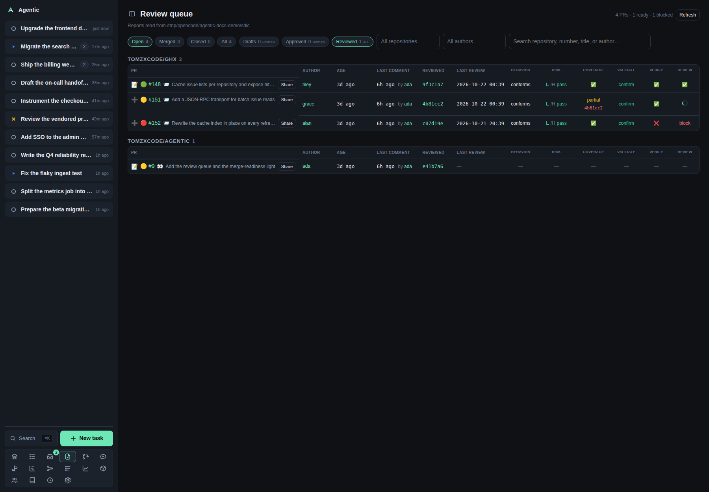

# Review queue

`/reviews` is the list of pull requests that need your review, with what each review step concluded.

## Problem

A review is not one decision: it is several steps, each with its own report and its own commit, and a pull request can be waiting on you without any of them having run.
The queue puts one row per pull request, a column per review step, one shared column for the conditional surface reviews, and a merge-readiness light beside the number, so you can see what is done, what is stale, and what still blocks a merge.
It reads the reports your review skills wrote under `AGENTIC_SDLC_DIR`, plus the pull requests GitHub says are waiting for you.

## How to use it

### Where the rows come from

Two sources, merged into one list:

- The review reports in the store, at `{owner}/{repository}/pull-requests/{number}/`.
- The review scan, which asks GitHub for the pull requests with a review requested from you (`review-requested:@me`) and the open ones you already reviewed (`reviewed-by:@me`). A pull request it finds joins the queue before any report exists for it.

The scan's cadence and its repository policy are configured in **Settings → Review requests**, not on this page.

### The filters

| Filter | Behaviour |
| --- | --- |
| `Open`, `Merged`, `Closed`, `All` | Status chips. `Open` is the default, and a pull request whose state could not be read counts as open. Each chip counts the whole queue. |
| `Drafts` | Three states on repeat clicks: `hidden` (default), `only`, `all`. |
| `Approved` | Same three states, `hidden` by default: a pull request GitHub already approved needs no review from you. |
| `Reviewed` | Same three states, `all` by default: one you reviewed may still need a follow-up. |
| `All repositories` | A multi-select with a `Filter…` box and `Select all` / `Deselect all`. Nothing chosen means every repository. |
| `All authors` | The same multi-select over authors. |
| Search | `Search repository, number, title, or author…`. |

Status, drafts, repository, author, and search preferences are remembered on this device under `agentic.reviewQueueFilters`, so leaving and returning keeps them.
A repository or author that disappears from the queue is dropped from the selection on the next load.

When a filter hides the only matching rows, the empty state names the filter and offers to include it: `Include drafts`, `Include approved`, `Include reviewed`, plus `Clear search`, `Clear repositories`, `Clear author`, `Show all`, and `Show every pull request`.

### Reading a row

- The number links to GitHub, shows the merge-readiness light beside it, and carries the pull request title plus the readiness text in its tooltip.
- `✅` in the title means GitHub already approved the pull request, `draft` means it is a draft, `📨` means a review is requested from you, and `👀` means you reviewed it and it is still open.
- The author cell links to the person page, or to a greyed `person/new` link when no person carries that login.
- Age, last comment, the commit last reviewed, and when the last review ran are beside the number.
- A pull request with no report still appears if the scan found it, and its readiness light is yellow until reports arrive.

The readiness light:

| Light | Meaning |
| --- | --- |
| 🟢 green | The collected signals could be approved automatically. |
| 🟡 yellow | Something still needs attention, including a pull request with no report yet. |
| 🔴 red | A signal blocks approval. |

Green needs a non-draft pull request, no stale steps, a passing review, coverage not failing, no failing surface review, an adversarial verdict that is not `unproven`, and a risk verdict that is not `decide` or `investigate`.
Red follows any failing step in the chain, a risk verdict of `block` or `hold`, or an adversarial verdict of `breaks`.
The light reads the reviewed commits, not the head commit.

### The step columns

The columns are **Behavior**, **Risk**, **Adversarial**, **Coverage**, **Validate**, **Verify**, and **Review**, one per review step, followed by **Surfaces** for the conditional surface reviews.

A cell shows the step's verdict, or a mark when the report carries one; the adversarial verdict marks are `holds` ✅, `unproven` ⚠️, and `breaks` ❌, and its tooltip also names how many failures it reproduced.
A report that does not cover the newest reviewed commit shows the commit it does cover underneath, in red.
A step that is running now shows a spinner with the time it started, even before it has written a report.
A step with no report shows a dash.
Click any cell to read that report; a large one is truncated with a note (`Showing the first part of a large report.`).

The surface reviews are conditional: one only runs when the diff touches its surface.
The **Surfaces** cell therefore carries one compact token per surface that ran (**CLI**, **SDK**, **API**, **DB**), each with its verdict mark and opening its own report when clicked.
A report that does not cover the newest reviewed commit shows its short commit in red after the token.
A pull request that touches no surface shows a dash, and a surface with no report is never counted as stale.

### Actions per row

| Control | What it does |
| --- | --- |
| `➕` | Imports the pull request into a new task, like the repository view's `New task`. It becomes `📝` once a task is linked, and opens the task in its PR view. |
| `Share` | Opens the findings selector: pick the must, should, and may findings, then `Send to agent` starts a run on the task with a generated prompt. The app posts nothing to GitHub; the skill does. |
| `Refresh` | Re-reads the store and re-asks GitHub, bypassing the ghx metadata cache. |

Every check or uncheck in `Share` writes `include` or `skip` onto that finding in its state file, so the selection survives a reload.
`Prompt preview` shows what the agent will receive.
When no task is linked, the modal offers `Import into a task` instead of `Send to agent`.

## CLI and agent interface

There is no `agentic` command for this page: it is a reader over files a skill writes and over GitHub.

| Operation | CLI | HTTP |
| --- | --- | --- |
| Read the queue | none | `GET /api/reviews?refresh=true` |
| Read the queue for one task | none | `GET /api/reviews/task/{task_id}` |
| Read one report | none | `GET /api/reviews/report/{number}/{name}?repository=owner/name` |
| Read the findings | none | `GET /api/reviews/findings/{number}?repository=owner/name` |
| Record include or skip | none | `POST /api/reviews/findings/{number}/decisions` |
| The scan's state | none | `GET /api/reviews/scan` |
| Run the scan now | none | `POST /api/reviews/scan` |
| Import a pull request into a task | `agentic task create --github-url <url>` | `POST /api/tasks` |
| Send the findings to an agent | `agentic run create <task> --prompt "…"` | `POST /api/tasks/{id}/runs` |

For an agent, the loop is: run `/review-pr-full` on the pull request, which writes the reports and state files, then read `GET /api/reviews` to see the result.
The report format is the skill's, so the queue needs no command of its own.

## Related

- [How to read the review queue](../how-to/review-pull-requests.md) for the walkthrough and the scan settings.
- [Task](task.md) for the same PR panels on a task, with the agent panel that acts on them.
- [Items](items.md) for one pull request's reviewers and reports.
- [My PRs](my-pulls.md) for the pull requests you authored.
- [Configuration](../reference/configuration.md) for `AGENTIC_SDLC_DIR` and the `AGENTIC_REVIEW_SCAN_*` keys.
