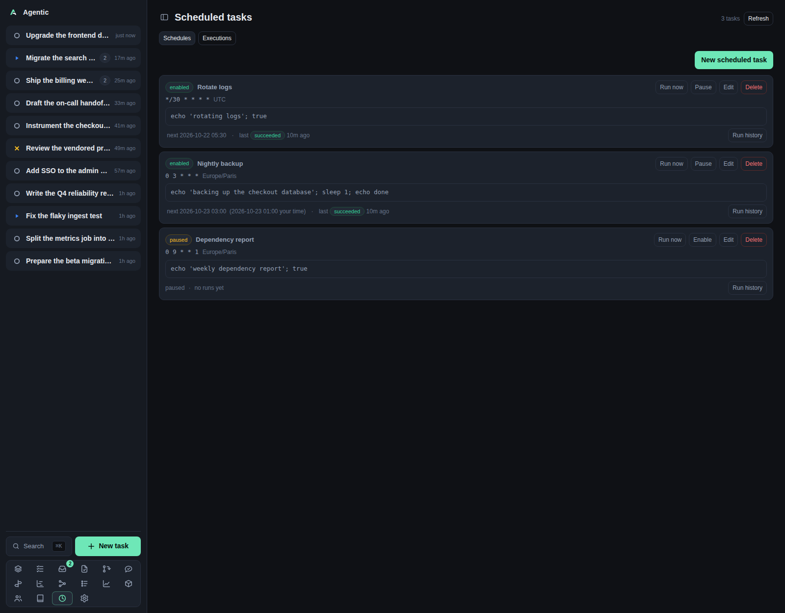

# Scheduled tasks

`/schedules` runs shell commands on a cron schedule inside the API process, and keeps their output.

## Problem

Some work should happen without you: a nightly backup, a report, a cleanup.
Putting it in crontab hides it from the app, and the output goes to a log you never read.
This page keeps the schedule, the last status, the next run, and every run's combined output in one place.

## How to use it

### The page

The header reads `Scheduled tasks` with a count and a `Refresh` button, and there are two tabs:

| Tab | What it shows |
| --- | --- |
| `Schedules` | One card per scheduled task, with its cron, timezone, working directory, next and last run, and run history. |
| `Executions` | Every run across every task, newest first, with `Show output`. |

`New scheduled task` reveals the form.
Several rows can have their edit forms open at once, each keeping its own draft, and only one row's run history opens at a time.

### The form

| Field | Notes |
| --- | --- |
| `Name` | A label, for example `Nightly backup`. |
| `Schedule (cron: minute hour day month weekday)` | A five-field cron expression, for example `0 9 * * *` or `*/15 * * * *`. |
| `Timezone` | An IANA zone, for example `Europe/Paris`, defaulting to your browser's zone. |
| `Shell command` | Run through the shell, so pipes, redirects, and `&&` work. |
| `Working directory (optional)` | Empty means the server's own directory. |
| `Enabled` | On by default; unchecking it keeps the schedule without firing it. |

While you type, `Next 5 runs in <zone>` lists the upcoming runs and adds `· <local> your time` when the zones differ.
The preview is computed in your browser, so it is instant and it can differ from the server by one run inside the repeated hour of a daylight-saving fall-back.

Validation messages name the problem: `A schedule is required`, `A schedule needs 5 fields…`, `'x' is not a valid cron expression`, `'<zone>' is not a known timezone`.

### Row actions

| Action | What it does |
| --- | --- |
| `Run now` | Starts the command immediately and expands that row's history. |
| `Pause` / `Enable` | Stops or resumes the schedule. |
| `Edit` | Opens that row's form in place. |
| `Delete` | Deletes the task and its run history, after a confirmation. |
| `Run history` / `Hide runs` | Shows the last 20 runs with status, start time, duration, exit code, and output. |

### How runs behave

- A run starts in the background, so the API returns at once and the history fills in when the command finishes.
- The scheduler wakes every `AGENTIC_SCHEDULED_TASK_TICK` seconds (`30` by default), so a run starts within that window of its scheduled minute.
- The next occurrence is advanced before the command starts, so a slow command is never started twice for the same occurrence.
- A command is stopped and marked failed after `AGENTIC_SCHEDULED_TASK_TIMEOUT` seconds (`3600` by default, `0` disables it).
- A run interrupted by a restart is marked failed the next time the API starts.
- The scheduler lives in the API process, so nothing fires while `agentic-server` is stopped.

### Live updates

The schedules tab reloads silently every 15 seconds while it is visible, and at once when you return to the browser tab.
The executions tab does the same, and polls every 2 seconds while any run is running.
A row with a running command polls its own history every 1.5 seconds.
A failed silent poll keeps the last good list.

### Good to know

- `/api/schedules/preview` returns the server's own answer for a cron expression when you need the exact one.
- The list shows the next run in the task's timezone with your local time beside it when they differ.
- Deleting is the only way to clear a run history; there is no per-run keep or prune.

## CLI and agent interface

| Operation | CLI | HTTP |
| --- | --- | --- |
| List | `agentic schedule list` | `GET /api/schedules` |
| Read one | `agentic schedule get <schedule>` | `GET /api/schedules/{id}` |
| Create | `agentic schedule create --name backup --schedule "0 3 * * *" --command "make backup" --timezone Europe/Paris` | `POST /api/schedules` |
| Update or pause | `agentic schedule update <schedule> …` | `PATCH /api/schedules/{id}` |
| Delete | `agentic schedule delete <schedule>` | `DELETE /api/schedules/{id}` |
| Run now | `agentic schedule run <schedule>` | `POST /api/schedules/{id}/run` |
| One task's runs | `agentic schedule runs <schedule> --limit 20` | `GET /api/schedules/{id}/runs` |
| Every task's runs | `agentic schedule runs --limit 100` | `GET /api/schedules/runs` |
| One run's output | none | `GET /api/schedules/runs/{run_id}` |
| Preview a cron expression | none | `GET /api/schedules/preview?schedule=&timezone=&count=` |

An agent that creates a schedule without `--timezone` gets the server's zone, not the browser's.
The in-browser preview is UI-only.

## Related

- [How to schedule a shell command](../how-to/schedule-a-script.md).
- [Configuration](../reference/configuration.md) for `AGENTIC_SCHEDULED_TASK_TICK` and `AGENTIC_SCHEDULED_TASK_TIMEOUT`.
- [HTTP API](../reference/http-api.md) for the `/api/schedules` endpoints.
