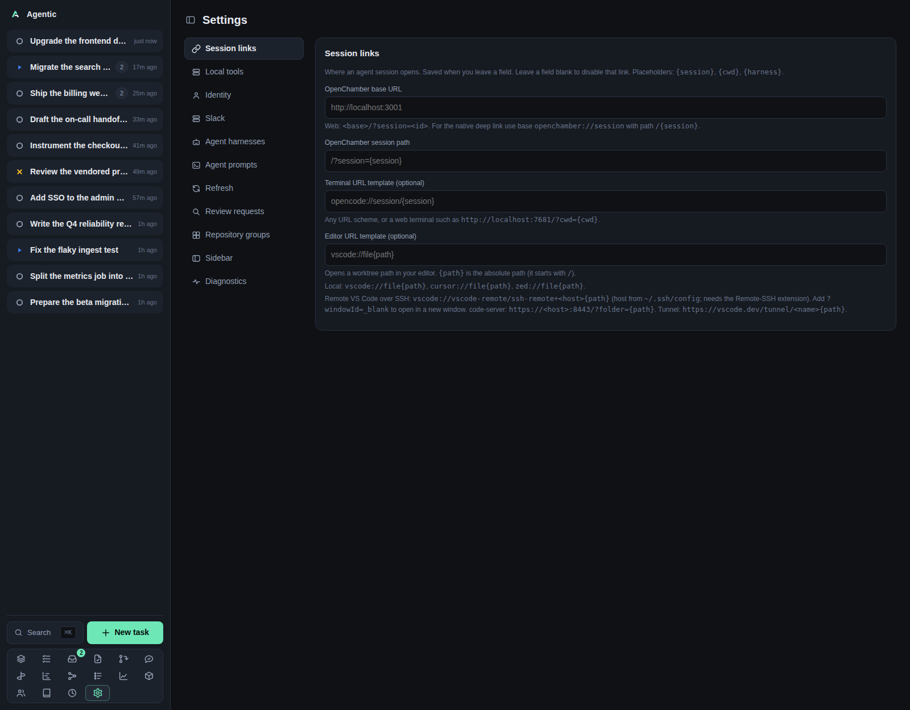

# Settings

`/settings` configures how the app reaches external tools, agents, and Slack, without editing environment files.

## Problem

Most of what the app needs is a credential or a URL that changes per machine: which harness to run, where OpenChamber lives, which GitHub login counts as you, how often to re-fetch items.
The Settings page collects those, shows the value in effect, and saves an override that wins over the environment variable.
Each section keeps its own draft, so editing one never touches another.

## How to use it

The page is a left nav of sections and a right panel.
The chosen section is kept in the `?section=` query, so a section is linkable and the command palette can jump straight to it.
All sections stay mounted, so switching back and forth does not lose what you typed.

| Section | What it edits |
| --- | --- |
| `Session links` | The OpenChamber base URL, the OpenChamber session path, the terminal URL template, and the editor URL template. |
| `Local tools` | The ghx and slackx web UI base URLs. |
| `Identity` | The GitHub login that counts as you. |
| `Slack` | The Slack recipient ids, the bot token, and `Send test notification`. |
| `Agent harnesses` | Per harness: its resume command, its model, and which harness is the default. Also adds a harness. |
| `Agent prompts` | The prompt buttons the agent panel shows, their item kind, their label, and their template. |
| `Checklists` | Reusable task checklists and the rules that decide which tasks they apply to. |
| `Refresh` | The Slack and GitHub refresh policies, their live preview, and a per-source force refresh. |
| `Review requests` | The review-scan cadence, the default repository policy, each repository's own policy, `Scan now`, and the last scan's result. |
| `Repository groups` | Named sets of repositories, with a description. |
| `Sidebar` | Which pages the sidebar shows and in what order. |
| `Diagnostics` | Read-only presence, version, path, and cache statistics for every external command and harness. |

### Session links

`OpenChamber base URL` and `OpenChamber session path` combine into the **Open in OpenChamber** link; the path defaults to `/?session={session}`.
`Terminal URL template (optional)` takes `{session}`, `{cwd}`, and `{harness}`.
`Editor URL template (optional)` takes `{path}` and drives the worktree **Open in editor** button, for example `vscode://file{path}`.

Fields save when they lose focus, and the panel shows `saving…` then `saved`.

### Local tools

`ghx server URL` and `slackx server URL` are the base URLs of `ghx serve` and `slackx serve`, not their RPC endpoints.
When one is set, GitHub and Slack items gain an **Open in ghx** or **Open in slackx** link.
Leaving a field blank hides that link.

A tool on the `managed` transport has no URL field: the server starts that tool's serve process itself, so the page shows a link to its web UI with the port the process actually bound (a configured URL keeps its host, since that is how you reach this machine), and whether the process is running.
The process listens on all interfaces, so the same port works from another machine.

### Identity

`Your GitHub login` is who counts as you: a merged pull request this login authored and a task links becomes a change, and the inbox and repository views only offer to record changes for its pull requests.
Blank falls back to the authenticated `gh` account, which the placeholder shows when it can be detected.

### Slack

The section is titled `Slack events`.
`Slack user id` is the default recipient; `Slack events user id` and `Slack events channel` override it per use.
`Slack bot token` posts as a bot instead of as you, and `Send test notification` posts one message and reports the result or Slack's error.

The item poke action still uses `SLACK_TOKEN`, not the bot token set here.

### Agent harnesses

Each harness card shows whether it is the default, whether its command is on `PATH`, and its status.
`Resume command` renders the **Copy resume command** button and takes `{session}`, `{cwd}`, and `{harness}`.
`Model` selects the model over ACP; blank means the harness's own default, shown as the placeholder.
`Set default` makes that harness the one a task or run uses when it names none.

The create form takes `Name`, `command`, `args`, and an optional `model`.
Deleting a harness is CLI-only (`agentic harness delete`).

### Agent prompts

Each row is a prompt with an item kind (`issue` or `pull_request`), a label, and a template.
The template uses the task and item variables listed in [Configuration](../reference/configuration.md).
`Add prompt` appends a row, `✕` removes one, and `Reset to defaults` restores the two seeded prompts, **Review PR** and **Triage issue**.

A prompt appears in the agent panel only when the task links exactly one item of that kind.
Every edit saves the whole list, and a row with an empty template is skipped until you fill it.

### Checklists

A checklist template has a name, an optional description, a set of rules, and a list of items.
A rule matches one task property: status, priority, waiting-on person, tags, people, requesters, repositories, or before/after/related tasks.
Every rule has to match.
`Add rule` appends a rule, `✕` removes one, and the items are one per line.

When a task matches, its items are copied onto the task once.
`Apply now` adds any missing items to the tasks that currently match, which is how a newly added item reaches tasks that already had the checklist.
Removing a template also removes the items it put on tasks; the task page keeps the items when a rule stops matching, shown disabled.

### Refresh

Two policy fields, `Slack threads` and `GitHub issues/PRs`, each a comma-separated list of `age=interval` bands with an optional `*` fallback.
The preview re-parses what you type after a 300 ms pause and shows the resulting schedule.
`Force refresh` re-fetches every item of that source immediately.

The status line reads `Last run: <age> · N refreshed · M failed · forced · N refreshed in the last 24h`.
An empty policy disables that source.

### Review requests

`How often to scan` is a duration such as `30m`, `1h`, or `1d`; blank stops the scan.
`Repositories with no policy of their own` chooses whether a repository with no policy is scanned (`Include`) or skipped (`Exclude`).
Each repository then has its own `Default`, `Include`, or `Exclude`.
`Scan now` runs one pass, and the section shows when the scan last ran, how many it found and kept, and any error.

`Review SLO` is how long a pull request may await your review before the inbox flags it, such as `8h` or `1d`; blank turns it off.
`Review nudge SLO` is how long a pull request of yours may wait without any review from anyone before the inbox offers to poke its reviewers, such as `1h30m` or `1d`; blank turns it off.
Both accept a combination of units (`1h30m`), and the durations a field takes are the same shapes the scan cadence does.

The queue the scan feeds is the [Review queue](reviews.md).

### Repository groups

A group is a name, a description, and a set of repositories.
Picking one on a task tells the agent which checkouts may hold information about it.
`Remove` asks for confirmation and leaves the tasks that use the group working, just without a group.

### Sidebar

Each page has a checkbox, and each row has a drag grip and `ArrowUp`/`ArrowDown` to move it.
`Reset to default` appears once you have changed something.
This preference is per device, under `agentic.sidebarNav`, and never reaches the server.

### Diagnostics

Three groups: `Runtime`, `Helper tools`, and `Agent harnesses`, each row showing whether the command is installed, whether it is required, its version, and the path it resolved to.
Below them, the ghx cache table (issue and pull request counts, cache age, staleness, and per-operation hit rates) and the slackx cache table (workspace, path, and entity counts with when each was last updated).

`Recheck` probes again.
Version probes time out after 5 seconds and cache listings after 30.

### Good to know

- A stored override wins over the matching environment variable; clearing the field falls back to the default.
- The section that writes through another endpoint is `Review requests`: a per-repository policy is a `PATCH` on that repository.
- The buttons that act rather than save a value are `Send test notification`, `Force refresh`, `Scan now`, `Set default`, `Add harness`, and `Recheck`.
- The page loads settings and repositories once; each section seeds its own editable copy from the overrides.

## CLI and agent interface

| Operation | CLI | HTTP |
| --- | --- | --- |
| Read effective settings and overrides | `agentic settings get` | `GET /api/settings` |
| Set a link template or refresh policy | `agentic settings set --openchamber-url … --terminal-url-template … --slack-refresh-policy … --github-refresh-policy …` | `PATCH /api/settings` |
| Preview a refresh policy | none | `POST /api/settings/refresh-policy/preview` |
| Refresh status per source | `agentic settings refresh-status` | `GET /api/settings/refresh-status` |
| Force a source refresh | `agentic item refresh-source github` | `POST /api/items/refresh-source/{source}` |
| Harnesses | `agentic harness list/create/update/delete` | `GET`/`POST`/`PATCH`/`DELETE /api/harnesses` |
| Set the default harness | none | `PATCH /api/harnesses/{id}` with `is_default` |
| Diagnostics | none | `GET /api/settings/diagnostics` |
| Repository groups | none | `GET`/`POST`/`PATCH`/`DELETE /api/groups` |
| Review scan | none | `GET`/`POST /api/reviews/scan` |
| Repository scan policy | none | `PATCH /api/repositories/{id}` with `review_scan` |
| Send a test Slack notification | none | `POST /api/slack/test` |

`agentic settings set` covers only the link templates and the two refresh policies.
The GitHub login, the Slack ids and token, the local tool URLs, the agent prompts, the review-scan settings, the sidebar, and every diagnostics probe are UI or HTTP only, so an agent that needs them has to call the API directly.

## Related

- [Configuration](../reference/configuration.md) for every environment variable and the settings they override.
- [How to configure session links](../how-to/configure-session-links.md).
- [How to refresh items on a schedule](../how-to/refresh-items.md).
- [Review queue](reviews.md) for what the scan produces.
- [Repositories](repositories.md) for the checkouts the groups collect.
