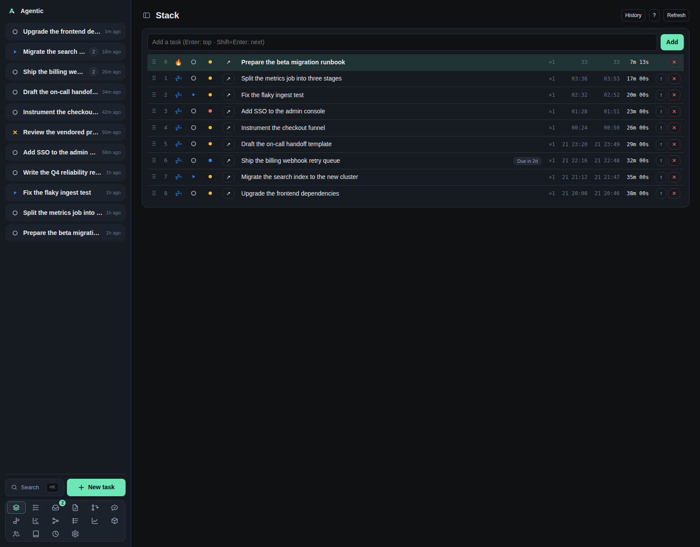

# Stack

The Stack at `/stack` is the focus queue: the task you are on right now on top, everything else behind it.

## Problem

A list sorted by recency does not tell you what to do next, and it does not survive a context switch.
The Stack keeps one ordered queue of the work in flight, with the current task at position 0, and records how long each task has been current.
You never add work by hand: every open, in-progress, or blocked task is on the stack, and a parked task leaves it until its date passes.

## How to use it

### The table

Each row carries its position, its status, its priority, the title, a deadline badge, a `Waiting on <name>` badge when it waits on someone, its execution count (`×3`), when it started, when it was last current, and the total time it has been current.

| Column | What you can do |
| --- | --- |
| `⠿` | Drag handle. Touch and pen can only drag from here. |
| Position | The current task is `🔥`, queued tasks are `💤`. |
| Status | Opens the status picker; setting `Done` completes the task and it leaves the stack. |
| Priority | Opens the priority picker. |
| `↗` | Opens the task page. |
| Title | Click to edit in place. |
| `↑` | Promote the row to current. Hidden on the current row. |
| `✕` | Remove the entry. The task itself is kept. |

Dragging reorders live and saves on release.
Dragging is disabled while a filter is set, because the positions on screen are not the positions in the queue.

### Adding and filtering

The input at the top does both jobs.
Type a title and press `Enter` to add it to the top, or `Shift+Enter` to add it right after the current task.
Type a substring to filter the list, and clear it to get the full queue back.

A new task pushed onto the stack clears its snooze and its wait, so it is current rather than parked.

### Keyboard shortcuts

With the input focused:

| Key | Action |
| --- | --- |
| `Enter` | Add the typed title to the top. |
| `Shift+Enter` | Add it right after the current task. |
| `↑` / `↓` | Move the selection. |
| `Esc` | Clear the input. |

With the page focused:

| Key | Action |
| --- | --- |
| `Enter` | Edit the selected row's title. |
| `↑` / `↓` | Move the selection. |
| `←` / `→` | Move the row one position. |
| `Home` or `/` | Promote the selected row to current. |
| `Delete` or `Backspace` | Remove the selected entry. |
| `0` to `9` | Select by index. `0` is the current task, so `1` is the second row. |
| `Esc` | Clear the selection and the filter. |

Modifier combinations are ignored, so `Cmd/Ctrl` shortcuts still reach the browser.

### The other tabs

`History` lists removed and completed entries with their duration and when they left.
`?` shows the shortcut list.
The history reloads every time you open it, and again after a removal, but `Refresh` only reloads the queue itself.

### The tray companion

`agentic-stack` puts the current task in a tray icon, with the stack depth as a badge.
Its menu opens the stack page and has a `Mark Done (pop)` action, and it re-reads the stack every 30 seconds.
The global hotkey defaults to `Ctrl+Shift+T`.
It talks to the API over HTTP, so it needs a running server.

### Good to know

- The current task's duration ticks every second while the page is open.
- Everything on the page is a `StackEntry` plus a `TaskSession`; a task can exist without being queued, and its history survives independently.
- Removing an entry from the stack is not the same as completing it: removal keeps the task open, while `pop` (or setting it `Done`) finishes it.

## CLI and agent interface

| Operation | CLI | HTTP |
| --- | --- | --- |
| Read the queue | `agentic stack list` | `GET /api/stack` |
| The current task | `agentic stack current` | `GET /api/stack/current` |
| Push a new task | `agentic stack push --title "Fix ingest" --position top` | `POST /api/stack` |
| Push an existing task | `agentic stack push --task-id <task> --position next` | `POST /api/stack` |
| Complete and promote the next | `agentic stack pop` | `POST /api/stack/pop` |
| Promote an entry | `agentic stack promote <entry>` | `POST /api/stack/{id}/promote` |
| Reorder an entry | `agentic stack reorder <entry> 3` | `POST /api/stack/reorder` |
| Edit the task behind an entry | `agentic stack edit <entry> --title … --description …` | `PATCH /api/stack/{id}` |
| Remove an entry | `agentic stack remove <entry>` | `DELETE /api/stack/{id}` |
| History | `agentic stack history` | `GET /api/stack/history` |
| Change a row's status or priority | `agentic task update <task> --status … --priority …` | `PATCH /api/tasks/{id}` |

`--position` takes `top`, `next`, or `last`.
Filtering, drag and drop, and the arrow and digit navigation are UI-only.

## Related

- [Tasks](tasks.md) for the wider list, including done and archived.
- [How to use the focus stack](../how-to/use-the-focus-stack.md).
- [Concepts](../explanation/concepts.md) for stack entries and task sessions.
