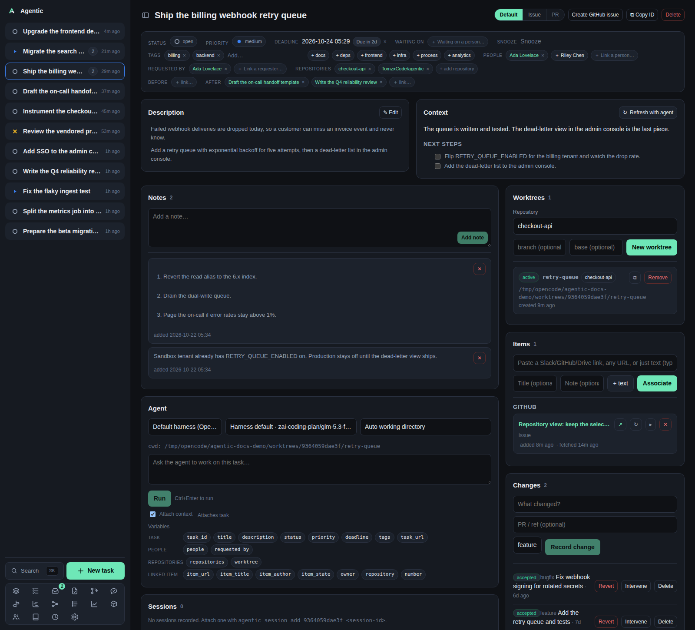

# Task

`/task/:id` is the working surface for one task: its description, its agent-maintained context, the evidence linked to it, the worktree the agent runs in, and every run, change, and event it accumulated.

## Problem

Resuming a task means re-reading a dozen places: the issue, the Slack thread, the checkout, what the last agent concluded, what you decided to do next.
The task page collects all of it so you can pick the work back up in under a minute.
It is also the page that drives the agent, so the prompt, the worktree, and the transcript sit next to the context they are about.

## How to use it

### The head

- The title is editable: click it, press `Enter` or `F2`, then `Enter` to save and `Esc` to cancel.
- The view switch has three modes: `Default`, `Issue`, and `PR`. A mode is disabled with a tooltip when the task links no item of that kind, and the mode is kept in the URL so a link can open straight into it.
- `Create GitHub issue` appears when the app has a registered repository with a `github.com` remote. With exactly one GitHub repository linked to the task it creates immediately; otherwise it asks which one, offering the task's own repositories first, then every registered GitHub repository. The new issue is linked to the task as an item.
- The newest run's session links sit in the head, where the command button reads `Resume`; the full `Copy resume command` with the command itself is in the Sessions panel.
- `⧉ Copy ID` puts the task id on the clipboard. `Delete` asks for confirmation and returns you to the list.

### The properties panel

| Field | What you can do |
| --- | --- |
| Status, Priority | Pick a new value; it saves at once. |
| Deadline | Pick a date and time. `Enter` confirms, `Esc` cancels, clicking away without a change cancels. |
| Waiting on | Name the person you are waiting on and an optional check-back date. The task becomes `Blocked` and leaves the stack until the date passes or you clear the person. |
| Snooze | Park the task until a date without changing its status. It returns to the stack when the date passes. |
| Tags | Type and press `Enter` or `,` to add; `Backspace` removes the last one. |
| People | Link the people involved, including suggested people taken from the linked items' authors and commenters. |
| Requested by | Link whoever asked for the task. |
| Repositories | Link the checkouts the work touches. |
| Dependencies | Link a task `before` or `after` this one, and unlink with `×`. The API refuses a link that would close a cycle. |

### The panels

| Panel | What it does |
| --- | --- |
| Description | Markdown body. `✎ Edit` opens the editor; links and `
` inside it stay clickable. |
| Context | The agent-written `summary` and `next_steps`. `↻ Refresh with agent` starts a context run, and next steps render as a task list whose checkboxes you can tick. `↻ Name & summarize` appears when a Slack item is linked. |
| Notes | Short notes, added with `Add note` or `Ctrl/Cmd+Enter`, edited in place, removed with `✕`. |
| Items | Paste a Slack, GitHub, or Drive link (the source is inferred), add a title and a note, then `Associate`. Each row can be refreshed, expanded, unlinked, marked `Done` or `Reopen` (Slack), and opens in ghx or slackx when those URLs are configured. |
| Changes | Record what changed and its class, then move it through `Verify`, `Accept`, `Reject`, `Revert`, or record an `Intervene` with a kind. |
| Worktrees | Create a worktree from one of the task's repositories, with an optional branch and base. `✎` opens it in your editor, `⧉` copies its path, `Remove` deletes it from disk after a confirmation. |
| People | The linked people and requesters, with a link to each person page. |
| Sessions | Agent sessions recorded against the task, including ones you attach by hand with `agentic session add`. |
| Timeline | The task's events with their client and actor, plus time spent in each status. |
| Agent | The harness picker, the model picker, the worktree picker, the Settings prompt buttons, the prompt box, the transcript, and the run history. |

### The agent panel

The harness picker defaults to the harness marked default in Settings.
The model picker lists what that harness's ACP session offers and defaults to the harness's own model, so a single run can answer with a different model without changing the harness.
The worktree picker decides the working directory; `Auto` uses the task's worktree, then its first repository.
Prompt buttons come from **Settings → Agent prompts** and appear only when the task links exactly one item of the button's kind.
`Ctrl+Enter` in the prompt box runs the prompt.
The `Attach context` checkbox appends the task and its linked items after the message, separated by `---`, unless the message is a command starting with `$` or `/`.
The variable chips insert `{task_id}`, `{owner}`, `{number}`, `{li.a.item_url}`, and the rest at the cursor.
`History` reloads an earlier run's transcript; a queued or running run follows its stream.

### Issue and PR modes

`Issue` shows one panel per linked issue and one agent panel scoped to it.
`PR` shows each linked pull request with its merge-readiness light, the reviewed commit, a `Refresh`, a cell per review step, and the findings selector.
`Share` picks the must, should, and may findings and hands the selection to an agent run, which posts the review comments.
Each check writes `include` or `skip` onto that finding, and the app itself posts nothing to GitHub.

### Good to know

- The page reloads on task-stream events, so a run that finishes elsewhere updates here.
- A failed GitHub read falls back to the stored copy and says so on the panel.
- Removing an item does not ask for confirmation; removing a worktree, session, change, and task all do.

## CLI and agent interface

| Operation | CLI | HTTP |
| --- | --- | --- |
| Read, update, delete the task | `agentic task get/update/delete` | `GET`/`PATCH`/`DELETE /api/tasks/{id}` |
| Timeline | `agentic task timeline <task>` | `GET /api/tasks/{id}/timeline` |
| Context | `agentic context get <task>`, `agentic context refresh <task>` | `GET /api/tasks/{id}/context`, `POST /api/tasks/{id}/context/refresh` |
| Link an item or a URL | `agentic link add <task> --url … --item-id …` | `POST /api/tasks/{id}/items` |
| Refresh, finish, or reopen an item | `agentic item refresh/done/reopen <item>` | `POST /api/items/{id}/refresh`, `PATCH /api/items/{id}` |
| Dependencies | `agentic task link/deps/unlink` | `GET`/`POST`/`DELETE /api/tasks/{id}/dependencies` |
| People and requesters | `agentic person link <person> --task … --requested-by …` | `POST /api/tasks/{id}/people`, `/requesters` |
| Changes | `agentic change create/verify/accept/reject/revert/intervene` | `POST /api/changes`, `POST /api/changes/{id}/status`, `/interventions` |
| Worktrees | `agentic worktree create/list/remove` | `GET`/`POST /api/tasks/{id}/worktrees` |
| Runs | `agentic run create/list/events/cancel/stream/wait` | `GET`/`POST /api/tasks/{id}/runs`, `GET`/`POST /api/runs/{id}/…` |
| Sessions | `agentic session add/list/get/update/remove` | `GET`/`POST`/`PATCH`/`DELETE /api/tasks/{id}/sessions` |
| A model for one run | `agentic run create <task> --prompt "…" --model <model>` | `POST /api/tasks/{id}/runs` with `model` |
| Create a GitHub issue | none | `POST /api/github/issues` |
| Name and summarize | none | `POST /api/tasks/{id}/summary/refresh` |
| Review report and findings decisions | none | `GET /api/reviews/report/…`, `POST /api/reviews/findings/{n}/decisions` |

The CLI is the supported route for an agent: every write on this page except the three API-only rows has a command.
An agent should pass `--api-url` explicitly, because the client does not read `AGENTIC_API_URL`.

## Related

- [Concepts](../explanation/concepts.md) for the nouns on this page.
- [How agents are wired](../explanation/how-agents-are-wired.md) for the queue and the ACP session.
- [How to run an agent against a task](../how-to/run-an-agent.md).
- [Configure session links](../how-to/configure-session-links.md).
- [Review queue](reviews.md) for the same PR panels scoped to one repository.
