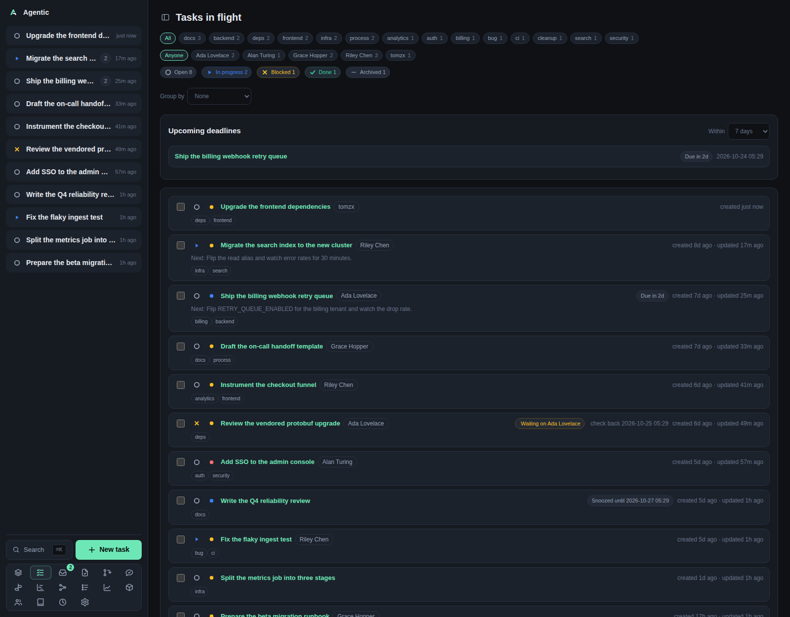

# Tasks

The task list at `/` is the app's home page: everything still in flight, one row per task.

## Problem

You have more work than you can hold in your head, spread across repositories, people, and dates.
The list answers "what is still open, and what should I look at next" without you opening each task.
It narrows by status, tag, person, and grouping, and it surfaces the deadlines coming up.

Done and archived tasks stay out of the way by default.
Their status badges still count them, so you can pull either back into view in one click.

## How to use it

### The page, top to bottom

| Section | What it shows |
| --- | --- |
| Tag row | `All` plus one chip per tag in use, with its count. Only shown when at least one task carries a tag. |
| Person row | `Anyone` plus one chip per person linked to an in-flight task, with their count. |
| Status badges | `Open`, `In progress`, `Blocked`, `Done`, `Archived`, each with a count. This is the status filter. |
| `Group by` | Splits the list into sections. |
| `Upcoming deadlines` | A `Within` window and the tasks due in it, overdue first. Hidden while a status filter is active. |
| Bulk bar | Floats at the bottom of the page once you tick a row: `N selected`, `Set status…`, `Set priority…`, `Add tags…`, `Remove tags…`, `Apply`, `Clear`, `Delete`. |
| Task rows | One flat list, or one section per group with a heading and count. |

### Filters and grouping

`Group by` offers `None`, `Status`, `Priority`, `Person`, `Tag`, and `Repository`.
A task that carries several people or tags appears under each of them.
`Repository` groups by a task's first repository only, so a task spanning several repositories shows up once.
Groups sort `Urgent` to `Low` by priority, and an empty `No …` group sorts last.

Click a status badge to filter by it and click it again to clear.
Click a tag chip or a person chip on a card to apply the same filter the tag and person rows apply.
Filters combine with AND, so a tag plus a person plus a status narrows to tasks that satisfy all three.

The counts tell you what a filter would show, not what it currently shows.
The status badges ignore the status filter but respect the tag and person filters.

### Changing tasks in place

| Control | What it does |
| --- | --- |
| Status icon on a row | Opens the status picker. Saves immediately. |
| Priority icon on a row | Opens the priority picker. Saves immediately. |
| Row checkbox | Starts a bulk edit. |
| `Apply` in the bulk bar | Sends the chosen status, priority, and tag additions and removals for every selected task. |
| `Delete` in the bulk bar | Deletes every selected task after a confirmation, including its runs and worktrees. |

Inline status and priority changes show first and roll back with an error toast if the save fails.
Selection is dropped whenever you change a filter, so a bulk edit never reaches a row you can no longer see.

### Keyboard shortcuts

These work anywhere in the app.

| Keys | Action |
| --- | --- |
| `Cmd/Ctrl+K` | Open the command palette, which fuzzy-searches actions and tasks. |
| `Cmd/Ctrl+N` | Open the new-task form. |
| `Cmd/Ctrl+B` | Hide or show the sidebar. |
| `f` | Turn on focus hints, which letter every control on the page. `Enter` confirms, `Backspace` undoes, `Esc` exits. |
| `Esc` | Close the palette or the open modal. |

### What persists

Grouping is remembered on the device, under `agentic.taskGroup`.
The status, tag, and person filters are in memory only and reset when you reload.
The deadline window is not remembered either.

### Good to know

- There is no sort control: rows arrive newest-updated first.
- There is no Refresh button: the list reloads when you navigate back to it.
- `Select every shown task` lives inside the bulk bar, so it only appears after you tick one row.

## CLI and agent interface

Everything the page reads is one endpoint, and the writes map onto the task commands.

| Operation | CLI | HTTP |
| --- | --- | --- |
| List and filter tasks | `agentic task list --status open --tag bug --q "ingest"` | `GET /api/tasks?status=&tag=&q=` |
| Upcoming deadlines | `agentic task deadlines --within-days 30` | `GET /api/tasks/deadlines` |
| Change a status | `agentic task update <task> --status done` | `PATCH /api/tasks/{id}` |
| Change a priority | `agentic task update <task> --priority 2` | `PATCH /api/tasks/{id}` |
| Edit many tasks at once | none | `POST /api/tasks/bulk` |
| Delete many tasks at once | none | `DELETE /api/tasks/bulk` |
| Ways to narrow the list | `--status`, `--tag` (repeatable, AND), `--q` | same as query parameters |

`--tags` on `agentic task create` and `agentic task update` sets the whole tag list, so an agent replaces tags rather than adding one.
Grouping, the deadline window, and the client-side person filter have no server equivalent.

## Related

- [Task](task.md) for one task's page and the agent panel.
- [Stack](stack.md) for the ordered queue of the same in-flight tasks.
- [How to use the focus stack](../how-to/use-the-focus-stack.md).
- [CLI reference](../reference/cli.md) for the full `agentic task` surface.
