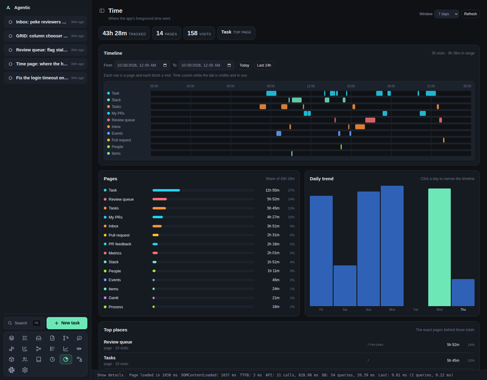

# Time

`/time` shows where the app's foreground time went: a timeline over a range you pick, the pages and exact places that took that time, and a daily trend.

## Problem

The app knows what you worked on (tasks, runs, events) but not where your attention went.
That makes it hard to notice a week lost to the review queue while the work that mattered sat untouched, or to tell whether a page earns the space it takes in the sidebar.
The Time page answers "where did the hours go" from the app's own traffic, with no external analytics service and no data leaving the machine.

## How a visit is recorded

- The web app records one visit for each stretch a page is open and visible.
- A visit ends on navigation, when the tab goes to the background, and after 15 minutes without pointer, key, or scroll input.
  An idle page is charged the 15 minutes, not the hours someone walked away.
- Visits shorter than a second are dropped as redirects, and so is anything over a day.
- Only the foreground tab records.
  Two visible windows record separately, so a window left open on a second monitor counts while you are not looking at it.
- Days are the browser's local days.
  The app sends its offset from UTC with each report, so a visit at 23:30 stays on the day you saw it.

Nothing is recorded before this page existed for the database it runs against: history starts when the app first loads with the tracker installed.

## How to use it

### The page

The header reads `Time` with `Where the app's foreground time went`, a window selector, and `Refresh`.
The summary strip holds the window's total time, the number of pages touched, the number of visits, and the page that took the most time.

### Timeline

One row per page, one block per visit, positioned across the range you pick with a time axis between them.
Hover a block for its time range and length.
The row order is by time inside the range, so the page you lived in is at the top.

`From` and `To` are date and time fields, so the range can be an hour, a day, or a week.
`Today` sets the range to the current day, and `Last 24h` to the last day up to now.
A range that ends before it starts is refused with a message instead of a chart.
Clicking a column in the daily trend narrows the range to that day.

A visit that overlaps the range is included even when it started before the range, and its block is clipped to the boundaries, so the parts shown are the parts inside the range.

### Pages

Every route in the window with its share of the time, largest first.
The colour is the page's own, stable across the timeline and these bars.

### Daily trend

One column per day of the window, the tallest day at full height, today labelled.
Click a column to inspect that day below.

### Top places

The exact paths behind the page totals, such as a single task or pull request.
Each row names the record it points at when it still exists (the task title, `owner/repo#42` for a pull request) and links to the page.
A record deleted since the visit keeps its time and shows no name.

### Visits in range

The range's visits, newest first, with their start and end time, the page, and the length.
When the range spans more than one day, the times carry their date.

## Limits

- Only the web app records.
  CLI and API activity is not time in the app.
- A tab left visible and in use for hours is recorded as such; the idle rule only cuts in after 15 minutes without input.
- In the daily totals a visit belongs to the day it started, so one that crosses midnight counts entirely on the earlier day.
  The timeline does the opposite: it includes a visit that overlaps the range and clips its block to the boundaries.
- Time is read on mount, on a window change, and on a start or end change.
  The page does not poll; `Refresh` re-reads both the window and the timeline.

## CLI and agent interface

| Operation | CLI | HTTP |
| --- | --- | --- |
| Record visits | none | `POST /api/page-visits` |
| Read the window report | none | `GET /api/page-visits/report?days=&tz_offset=` |
| Read one range's visits | none | `GET /api/page-visits/visits?start=&end=` |

The CLI does not expose page visits; an agent reads them over HTTP.
`days` defaults to 7 and `tz_offset` is the client's offset from UTC in minutes, east positive.
`start` and `end` are ISO instants; without them the visits endpoint answers for today's local day.
`POST /api/page-visits` takes `{ "visits": [ ... ] }`, each visit with `path`, `route_name`, `title`, `started_at`, and `ended_at`.
Recording a visit does not write an operations audit row, so the audit log stays a record of changes rather than of reading.

## Related

- [Events](events.md) for what happened, as opposed to where the time went.
- [Metrics](metrics.md) for how the work moved.
- [Concepts](../explanation/concepts.md) for the database and the local-first model.
